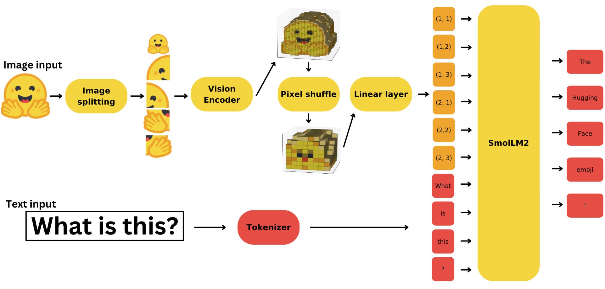
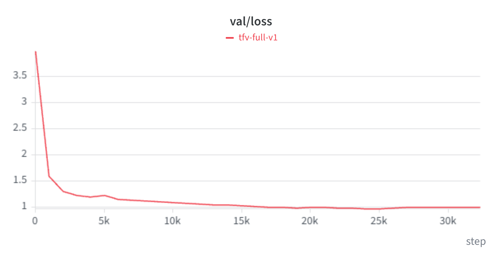
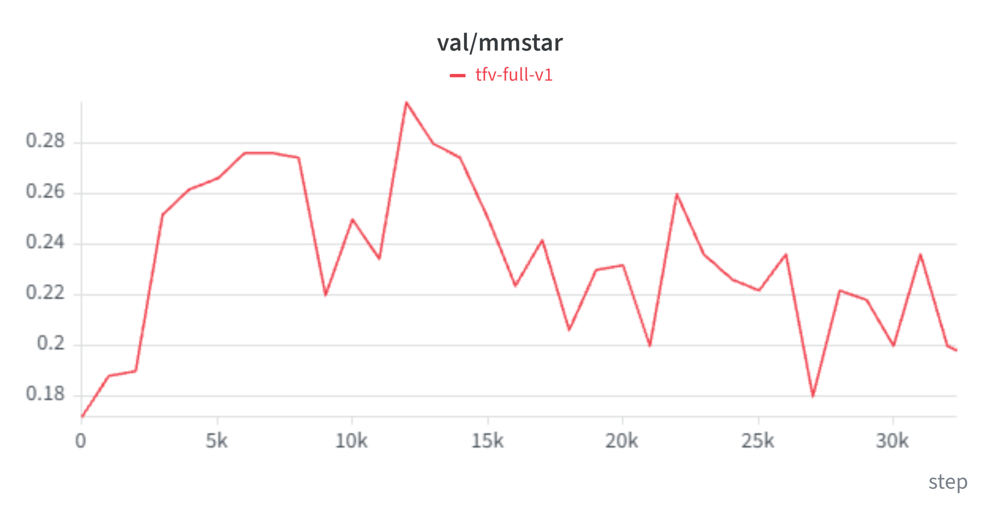

# TinyForge Vision

## Summary

TinyForge Vision continues our earlier TinyForge project, a language-only model, by adding vision.
We combined code from TinyForge, from [nanoVLM](https://github.com/huggingface/nanoVLM) (tag
`v0.1`) and new code of our own into a reusable repository for training a small vision-language
model (VLM). It follows the LLaVA-style architecture: the image is turned into a sequence of tokens,
and those image tokens and the text tokens go through the language model as a single sequence.

Our target was to reproduce nanoVLM v0.1: the same 222M-parameter model, trained on the same data,
and scored with the same MMStar evaluation, where the published checkpoint reaches 35.3%.

**What we found.** Our pipeline fits the training data as well as the original: validation loss
0.99, against 1.01 for the published checkpoint. On MMStar, however, our best checkpoint scores
**27.6%**, against **37.8%** for the published checkpoint under the same evaluation. Tracking down
the gap showed that the published checkpoint was not trained with the code tagged `v0.1`. It was
uploaded two weeks before the tag, and it was trained with a space between the prompt and the answer
(`Answer: Yes`). The tagged code has no space there (`Answer:Yes`), and we reproduced the tagged
code faithfully. The missing space is the most likely cause of the MMStar gap. We did not confirm
it by retraining.

## Architecture

  

The model has three parts: a vision encoder, a modality projector and a language model.

**Image path.** The image is resized to 224 x 224 and split into 16 x 16 pixel patches, which
gives a 14 x 14 grid of 196 patches. The vision encoder, a ViT (SigLIP-B/16-224), turns each patch
into a 768-dimensional feature vector, so the output is 196 x 768. A pixel-shuffle layer then
merges each 2 x 2 block of neighbouring patches into one token by concatenating their features.
This cuts the sequence to 49 tokens of 3,072 dimensions, four times fewer image tokens for the
language model to process, without dropping any information. Finally, a linear layer projects each
token to the language model's embedding size, giving 49 image tokens of 576 dimensions.

**Text path.** The question is wrapped in the prompt `Question: {question} Answer:`, tokenized,
and embedded with the language model's own token embeddings.

**Language model.** The 49 image tokens are placed in front of the text tokens, and the combined
sequence goes through the language model (SmolLM2-135M), which generates the answer one token at
a time. Training sequences are 128 tokens long: 49 image tokens plus up to 79 text tokens.

| Part | Choice | Parameters |
| --- | --- | --- |
| Vision encoder | SigLIP-B/16-224, 12 layers, 196 patches x 768 | 85.8M |
| Modality projector | Pixel shuffle (2 x 2) + linear layer, 3,072 -> 576 | 1.8M |
| Language model | SmolLM2-135M, 30 layers, hidden size 576 | 134.5M |
| **Total** | | **222.1M** |

Both backbones start from their pretrained weights. Only the projector starts from random
weights, so training mainly has to teach it to translate image features into something the
language model can read.

The diagram shows an image-splitting step. In nanoVLM v0.1, and in our model, that step is simply
the ViT's patching of one 224 x 224 image. There is no splitting into several sub-images.

## Validation

Before training anything, we checked that our code matches nanoVLM v0.1:

- **Model code.** We load the published checkpoint
  ([lusxvr/nanoVLM-222M](https://huggingface.co/lusxvr/nanoVLM-222M)) into our model. Tests compare
  our projector, forward pass, training collator and generation against the original v0.1 code,
  kept in `tests/reference/`.
- **Evaluation.** We scored the published checkpoint with our MMStar evaluation (the 1,500
  multiple-choice questions of the `val` split) on a CUDA GPU, with three seeds:

| Seed | MMStar accuracy |
| --- | --- |
| 0 | 37.87% |
| 1 | 38.60% |
| 2 | 36.80% |
| **Mean ± std** | **37.76% ± 0.91** |

This is 2.5 points above the published 35.3%. The evaluation samples its answers instead of
choosing the most likely one, so the score changes from run to run: the three seeds alone span
1.8 points. Another possible reason, found later (see
[Where the gap comes from](#where-the-gap-comes-from)): nanoVLM's earliest code ended the MMStar
prompt with a space (`Answer: `), while v0.1 ends it without one (`Answer:`). If the 35.3% was
measured with the older prompt, the prompt itself could account for part of the difference. We did
not test this. Either way, the published checkpoint and our model are scored with exactly the same
code, settings and seeds, so the fair baseline for our model is **37.8%**, with 35.3% kept as the
published reference.

## Training Setup

**Data.** We train on [the Cauldron](https://huggingface.co/datasets/HuggingFaceM4/the_cauldron),
a collection of 45 vision-language datasets covering, among others, charts, documents, diagrams,
OCR, tables, science questions and general visual questions. Like nanoVLM v0.1, we keep only the
first image and the first question-answer pair of each sample, which gives 1,672,052 samples. We
hold out 1% of them as a validation split, leaving 1,655,332 for training.

The raw Cauldron is about 143 GB, which is impractical to download in every Colab session. So we
preprocessed it once: each image is resized to 224 x 224 (the same resize the model applies) and
stored as JPEG. The result is about 30 GB, which we uploaded to the Hugging Face Hub as
[Juanillaberia/tinyforge-vision-cauldron-224](https://huggingface.co/datasets/Juanillaberia/tinyforge-vision-cauldron-224).
Training reads the same samples nanoVLM would, only faster.

**Objective.** Standard next-token cross-entropy, computed only on the answer tokens. The image
tokens, the question and the padding contribute nothing to the loss. Samples longer than the
128-token sequence are skipped instead of being cut off, so the model never learns from
truncated answers.

**Optimization.** We train the whole model: neither backbone is frozen. The randomly initialized
projector gets a learning rate 20 times higher than the pretrained backbones. All of these settings
match nanoVLM v0.1's `train.py`.

| Setting | Value |
| --- | --- |
| Optimizer | AdamW, betas (0.9, 0.999), weight decay 0.01 |
| Learning rate | 2e-3 for the projector, 1e-4 for the vision encoder and language model |
| Schedule | 3% linear warmup, then cosine decay to 10% of the peak |
| Batch size | 256 samples per optimizer step, no gradient accumulation |
| Epochs | 5 (32,330 steps) |
| Precision | bf16 autocast, `torch.compile` |
| Gradient clipping | None |

**During training.** Every 1,000 steps we compute the loss on the validation split and score
MMStar on its first 500 questions, to follow progress without spending too much GPU time. The
checkpoint with the best score on those 500 questions is kept as `best_mmstar`. These intermediate
scores are only for monitoring: every number in the Results section uses the full 1,500 questions
and three seeds. Every 1,000 steps a resumable checkpoint (model and optimizer) is saved to Google
Drive, so a dropped Colab session costs at most 1,000 steps.

**Hardware.** One NVIDIA A100-SXM4 80 GB on Google Colab, with 12 CPU cores. Training ran at about
620 samples per second (0.41 s per step) and used at most 47 GB of GPU memory. The full run,
including evaluations and checkpoints, took 250 minutes (about 4.2 hours) in a single session:
about 37 Colab compute units at 8.88 units per hour.

## Results

All MMStar scores use the full 1,500 questions, the same evaluation code and seeds 0, 1 and 2.
Validation loss is measured on our held-out 1% of the Cauldron.

| Model | MMStar (mean ± std) | Val loss | Notes |
| --- | --- | --- | --- |
| nanoVLM-222M, published | 35.3% | - | About 6 h on one H100 |
| nanoVLM-222M, scored with our eval | **37.8% ± 0.9** | 1.90 | Same checkpoint, our evaluation |
| TinyForge Vision, `best_mmstar` | **27.6% ± 1.1** | 1.05 | Step ~12,000 (about 1.9 epochs) |
| TinyForge Vision, `final` | 21.8% ± 0.9 | 0.99 | Step 32,330 (5 epochs) |
| Random guessing | about 25% | - | 4 options per question |

  
  

The two curves tell different stories. Validation loss falls quickly and then keeps improving
slowly until it flattens at about 0.99 in the last two epochs: on Cauldron-style data the model
never overfits. MMStar (first 500 questions) rises from 17% to a peak of 29.6% at step 12,000,
then drifts down to about 20% by the end. The training loss (not shown) also drops sharply at each
epoch boundary, a sign that the model partly memorizes samples it sees again.

So more training kept helping on the training distribution but hurt on MMStar. Part of this is
specialization: later epochs push the model further toward the Cauldron's answer styles, and fully
training both backbones can wear away some of what they learned in pretraining. The bigger question
is why even our best checkpoint is 10 points below the published one, more than seed noise
(about ±1 point) or checkpoint selection can explain.

**Checkpoint selection.** nanoVLM v0.1's `train.py` scores the full MMStar every 250 steps and
saves the model only when the score improves. It never saves the final model, so the published
checkpoint is almost certainly its best-MMStar checkpoint. That makes `best_mmstar` our
like-for-like comparison. Both selections pick a checkpoint using the benchmark we report on, which
flatters the score somewhat. nanoVLM's is more aggressive (about 130 full evaluations against our
32 evaluations on 500 questions), but this accounts for a point or two, not ten.

## Where the gap comes from

**Step 1: compare validation loss.** If our training were simply worse, the published checkpoint
should fit our validation split better. It does the opposite: 1.90 against our 0.99. A model trained
for 5 epochs on the Cauldron with the same code should not look like this.

**Step 2: rule out the attention mask.** Our only approved change to nanoVLM's model code merges
the causal and padding masks, because recent PyTorch rejects v0.1's original call. If nanoVLM had
actually trained with the padding visible, that would explain step 1. Recomputing validation loss
with the padding visible made every model worse, the published one most of all (1.90 to 2.70). So
nanoVLM trained with the padding masked, as we do.

**Step 3: check the history.** The published checkpoint was first uploaded to the Hub on
**May 1, 2025**. The `v0.1` tag is from **May 15, 2025**, and the repository's first public commit
is from May 2. Comparing that first commit with `v0.1` shows mostly renames, plus one change to the
training text:

| | First commit (May 2) | `v0.1` tag (our code) |
| --- | --- | --- |
| Prompt in `VQADataset` | `"Question: {q} Answer: "` | `"Question: {q} Answer:"` |
| Joining in `VQACollator` | `f"{text} {answer}"` | `f"{text}{answer}"` |
| Training text | `...Answer:  Yes` | `...Answer:Yes` |

**Step 4: test the format.** We recomputed validation loss with a space inserted before every
answer:

| Model | No space (v0.1 code) | Space before answer |
| --- | --- | --- |
| nanoVLM-222M, published | 1.90 | **1.01** |
| TinyForge Vision, `best_mmstar` | **1.05** | 2.25 |
| TinyForge Vision, `final` | **0.99** | 2.24 |

Each model is good only in the format it was trained in. This shows two things:

1. The published checkpoint was trained with a space before the answer, so it does not come from
   the code tagged `v0.1`.
2. Our training is as good as nanoVLM's in its own format (0.99 against 1.01). The data, model and
   training loop are working.

**Why would one space cost about 10 MMStar points?** The tokenizer splits text differently with and
without a space. With the space, an answer starts with ordinary word tokens such as `" Yes"` or
`" B"`, which SmolLM2 saw constantly during pretraining. Without it, the answer starts with tokens
glued to the colon, which were rare in pretraining. The model then has to learn its answers in a
part of the vocabulary it knows less well, and makes less use of its pretrained knowledge. The
answers on MMStar fit this picture. The published model answers with a letter after a space
(`" D"`). Ours answers in a pattern like `"C: D."`, which the lenient scoring still reads as a
letter, so the format of the answer is not what costs points. The quality of the choice is.

This last step is an explanation, not a measurement. Confirming it would take retraining with the
space restored, which we did not do (see [Next steps](#next-steps)).

## Qualitative Examples

**An open question.** Asked "What is this?" about nanoVLM's example image (a cat standing on
pebbles), the `final` model gives answers like:

> This picture contains a white and brown color cat. It is facing towards the left side of the
> picture

> In the center of the picture there is a black cat, it is standing on the pebbles. On

The model clearly sees the image: every answer describes the cat and the pebbles. The style
("In the center of the picture there is...") comes straight from `localized_narratives`, one of the
largest Cauldron subsets, made of long spoken descriptions. Colors are less reliable: the same cat
is described as white and brown in one answer and black in another.

**Multiple choice.** Five of the first 16 MMStar questions, answered by each model (raw output of
the 5-token sampled generation, seed 0):

| Correct | nanoVLM-222M | `best_mmstar` | `final` |
| --- | --- | --- | --- |
| D | `" D\nAnswer:"` | `"D: Home decoration"` | `" D: Music."` |
| C | `" A  "` | `"D: D."` | `"D: Dila."` |
| D | `" A\nD."` | `"D: B."` | `"D: B."` |
| B | `" B\nAnswer:"` | `"A: A."` | `"A: Abert."` |
| A | `" D\nD."` | `"D: A."` | `" D: A."` |

All three models answer with option letters. The published model puts a single letter after a
space. Ours writes a letter, a colon and often a second letter or a short phrase, and `final` leans
heavily toward "D" whatever the question, which suggests it guesses more than it reasons. On these
first 16 questions all three models score 8 out of 16, too few questions to separate them; the full
1,500 are what show the difference.

## Conclusions

- **The pipeline works.** Data preparation, model, training loop and evaluation reproduce nanoVLM
  v0.1's code, and the trained model reaches the same validation loss as the published checkpoint
  in its own format (0.99 against 1.01).
- **The published score does not come from the tagged code.** The `lusxvr/nanoVLM-222M` checkpoint
  predates the `v0.1` tag and was trained with a space before the answer, which the tag removed.
  Training exactly with the tagged code gives 27.6% on MMStar instead of 37.8%.
- **Validation loss does not predict benchmark score.** Our validation loss kept improving for all
  5 epochs while MMStar peaked at about 2 epochs. For a model this small, the best checkpoint for a
  benchmark has to be chosen on that benchmark, or better, on a separate one.
- **Small format details matter.** A single space changes which tokens the model answers with, and
  very likely costs about 10 points on MMStar. Reproducing a result means reproducing the exact
  training text, not just the code's logic.

## Next steps

The finding above is complete without more compute, but its last link (that the space causes the
gap) is untested. The cheapest test is a short run with the space restored in `VQACollator`: one
epoch is about 6,500 steps, roughly an hour on an A100. If its MMStar curve over those steps is
clearly above this run's (about 19-27% in the same range), the explanation holds. A full 5-epoch
run would then give the like-for-like number to compare with 37.8%.
